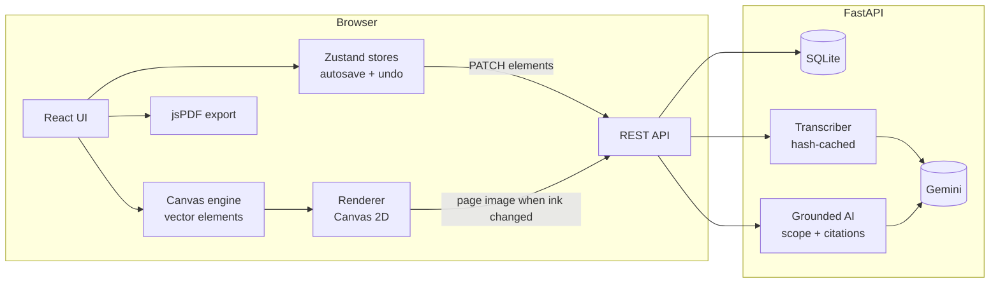

# Margin: Interactive AI Learning Canvas

> REQUIEM hackathon · PS 6 (Gen AI, TE/BE)
>
> *A notebook that has read your notes, handwriting included. Ask it questions, get quizzed, tidy pages up, and it tells you honestly when your notes don't cover something.*

Students write and draw on real HTML-canvas pages organised into projects. A Gemini-powered assistant reads those pages (typed text exactly; handwriting via a vision model), then answers questions, explains, summarises, quizzes and refines content using **only the student's notes**, citing the page each claim came from, and saying "not covered in your notes" when that's the truth.

---

## Quick start

You need **Python 3.11+** (with [uv](https://docs.astral.sh/uv/)) and **Node 20+**.

### 1. Backend (FastAPI, port 8000)

```bash
cd backend
uv venv --python 3.12 .venv
uv pip install --python .venv -r requirements.txt
cp .env.example .env        # then put your key in GEMINI_API_KEY
.venv/Scripts/python -m uvicorn app.main:app --reload --port 8000     # Windows
# .venv/bin/python -m uvicorn app.main:app --reload --port 8000       # macOS/Linux
```

Get a free key at [aistudio.google.com](https://aistudio.google.com/apikey). In `backend/.env`:

```ini
GEMINI_API_KEY=your-key
GEMINI_MODEL=gemini-3.8-flash            # free tier
GEMINI_FALLBACK_MODEL=gemini-3.5-flash-lite  # used automatically on rate limits
LLM_PROVIDER=gemini                      # "mock" = keyword-matching stand-in, no key needed
```

### 2. Frontend (Vite + React, port 5173)

```bash
cd frontend
npm install
npm run dev
```

Open http://localhost:5173 and click **Open the demo notebook**.

### One-process mode (for the demo laptop)

```bash
cd frontend && npm run build          # creates frontend/dist
cd ../backend && .venv/Scripts/python -m uvicorn app.main:app --port 8000
```

FastAPI then serves the built app and the API together at http://localhost:8000.

---

## Requirement coverage

| ID | Requirement | Where / how |
|---|---|---|
| C1 | Write & draw with the **HTML Canvas API** | Our own engine: `frontend/src/canvas/` (no whiteboard library). Three stacked `<canvas>` layers; `perfect-freehand` only computes stroke outlines, which we fill with `ctx.fill(Path2D)` |
| C2 | Erase | **Precise** eraser (`destination-out`, never cuts the paper) and **whole-stroke** eraser (segment-distance hit test) |
| C3 | Drawing properties | 6 ink + 4 highlighter colours, custom colour, width slider; recolours the current selection |
| C4/C5 | Add & edit text | Text tool places a `<textarea>` over the canvas; double-click text to edit; Select tool moves/deletes |
| C6 | Save | Debounced autosave (~0.9 s) with a "Saved ✓" indicator; undo/redo (Ctrl+Z / Ctrl+Y) |
| C7, P1–P3 | Projects & pages | Create/rename/delete notebooks; add, rename, duplicate, delete (with Undo), **drag to reorder**, switch (PgUp/PgDn) |
| P4 | PDF export in order | `export/pdfExport.ts` re-sorts by `order`, renders each page at 2×, adds title + "n / N" footers |
| A1 | Page vs project | Scope switch **Selection / This page / Whole project**; in project scope the current page is tagged `current="true"` |
| A2/A3 | Q&A + explain | Ask tab, with Answer / Explain modes |
| A4 | Summaries | Short / Detailed / Key terms, every bullet cites its page |
| A5 | Quizzes | MCQ, true/false, short answer (short answers graded by the AI against the notes) |
| A6/A9 | Refine with confirmation | Simplify, fix grammar, structure, improve answer, exam-ready → side-by-side review with word diff → *Insert as new page*, *Insert below*, or *Accept & replace* (second confirmation, one Ctrl+Z to undo) |
| A7/A8 | Grounding + "not enough info" | Structured output with `grounding` label + citations; **server verifies every quote** against the page text, drops fakes, downgrades unverifiable answers; "Explain from general knowledge" is opt-in and labelled |
| A10 | Handwriting understanding | Vision transcription per page, cached by content hash; **What the AI sees** lets students fix misreads |
| B1 | Flashcards | Leitner boxes (1 day → 2 weeks), flip cards, deck view |
| B2 | Adaptive quiz | Steps difficulty up/down from recent answers; weak topics get most questions |
| B3 | Revision sheet | One-page sheet of definitions, rules, must-remember points, likely questions; insert as page → PDF |
| B4 | Selected content | Lasso/click select → floating **Explain / Summarise / Improve / Quiz me** bar |
| B5 | Personalised learning | Insights tab: accuracy per topic, weak spots, "Quiz me on these", AI study plan |
| + | **Import existing notes** (the PS's "scattered notes" problem) | **Import** in the sidebar, on the home screen, or drag & drop: PDFs (one page each, text layer kept so the AI reads it exactly), photos/scans of handwritten pages (read by the vision model), `.txt` / `.md` / `.docx`, or a **whole folder** (files in name order, notebook named after the folder). Imported pages are the paper you write over |

---

## How it works



1. **Pages are vector data, not pixels.** Every stroke, eraser pass and text box is an element in a list (`elements_json`). Save, undo, PDF export, thumbnails and AI selection all replay that list.
2. **The AI can't read ink, so we read it first.** Each save changes the page's `content_hash`. Before any AI call, the browser renders pages whose handwriting hasn't been read for the current hash and sends the image (plus the exact typed text) to Gemini for a faithful transcript. Typed-only pages are transcribed for free on the server. No edit means no new call.
3. **Grounded answers.** The prompt packs pages as `<page n="2" title="..." current="true">`, and Gemini must return JSON with `grounding` (`grounded | partial | not_in_notes`), a markdown answer with `[p.N]` markers, and citations with verbatim quotes. `app/ai/grounding.py` fuzzy-matches each quote against that page's text; unverifiable quotes are dropped, and a "grounded" answer with nothing verifiable becomes "partial".
4. **Never overwrite silently.** Refine returns a proposal. Changes reach the page only through *Insert* (additive) or a double-confirmed *Replace*, which is a single undo step.

---

## Project layout

```
backend/
  app/
    main.py            app factory, envelope + error handlers, serves frontend/dist
    models.py          Project, Page, PageTranscript, ChatMessage, Quiz, QuizAttempt, Flashcard
    schemas.py         API validation + JSON schemas the LLM must follow
    repo.py            queries, ordering, transcript freshness (load_docs)
    learning.py        adaptive difficulty, topic stats, Leitner boxes (pure functions)
    seed.py            demo notebook; handwriting.py draws its "handwritten" pages as real strokes
    routers/           projects.py, pages.py, ai.py, assets.py (imported page images)
    ai/                llm_adapter.py (Gemini + fallback + mock), transcriber.py, context.py,
                       grounding.py, prompts.py, service.py (ask/summary/refine/...), study.py (quiz/cards/insights)
  tests/               pytest (72 tests)
frontend/src/
  canvas/              engine, renderer, hit testing, geometry, text layout, history (+ tests)
  store/               projectStore (pages, autosave, undo), aiStore (scope, page reading), canvasStore
  components/          home/, editor/ (CanvasStage, Toolbar, PageSidebar), ai/ (one file per tab)
  lib/importNotes.ts   PDF (pdf.js) / photo / text / docx (mammoth) / folder import
  export/pdfExport.ts
demo/                  eval_questions.json + eval_grounding.py
```

## Tests and evaluation

```bash
cd backend && .venv/Scripts/python -m pytest -q --cov=app     # 72 tests
cd frontend && npx vitest run                                 # canvas engine, layout, markdown, insert
backend/.venv/Scripts/python demo/eval_grounding.py           # needs the backend running with Gemini
```

`eval_grounding.py` asks 20 questions (single-page, multi-page, partly covered, not in notes) against a fresh demo notebook and reports **grounding-label accuracy**, **citation accuracy** and **refusal correctness**, written to `demo/eval_results.md` for the pitch slide.

## Design notes and deliberate choices

- **Stack:** one change from the planning doc. Tailwind is used only for layout utilities; the look (paper desk, red-pen accent, Fraunces + Atkinson Hyperlegible) comes from custom design tokens in `src/index.css`.
- **No token streaming:** answers are structured JSON whose citations are verified server-side before display. Streaming half-verified text would defeat that check, so we show a skeleton for the few seconds it takes.
- **Context size:** full-context mode includes up to 40 pages (`MAX_PAGES_IN_CONTEXT`), always keeping the current page. Retrieval with embeddings is the planned next step for larger notebooks.
- **Security:** the Gemini key lives only in `backend/.env`. All inputs are validated with pydantic (element counts, image size/type, enums). Note text is fenced inside tags the model is told never to obey. Markdown is rendered without raw HTML, and AI endpoints are rate-limited per client.
- **Imported files** are stored as assets in SQLite (`/api/assets/<id>`), never inline in the page JSON, so autosave stays small; image elements may only reference that store.
- **Demo laptop tip:** the database lives in `backend/data/` inside OneDrive. If OneDrive sync ever locks it, set `DATABASE_URL=sqlite:///C:/canvas-data/canvas.db` in `backend/.env`.
- **Mock mode** (`LLM_PROVIDER=mock`) is a keyword matcher for UI development. `/api/health` and the UI label it clearly; never demo with it.
